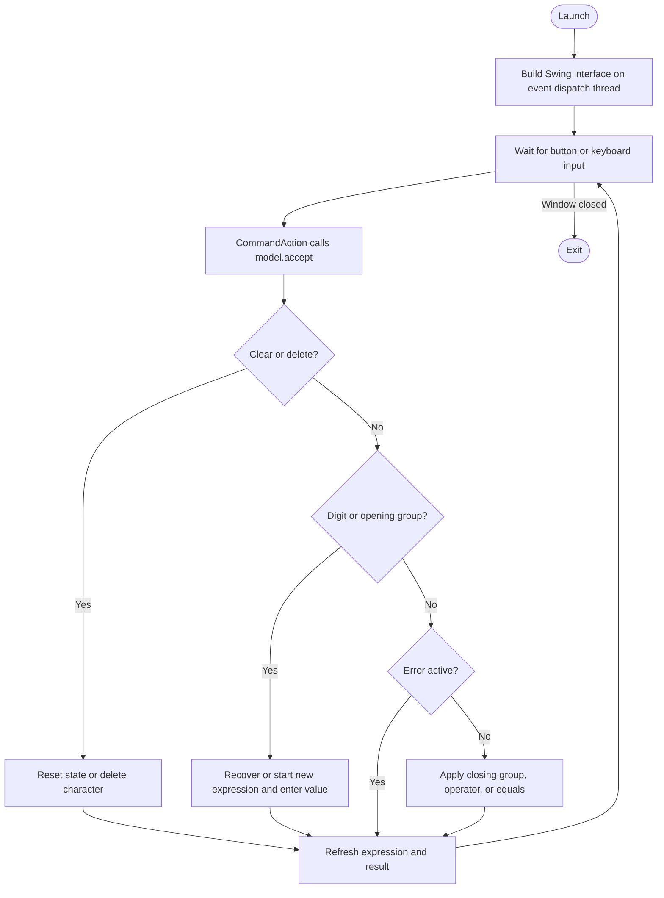
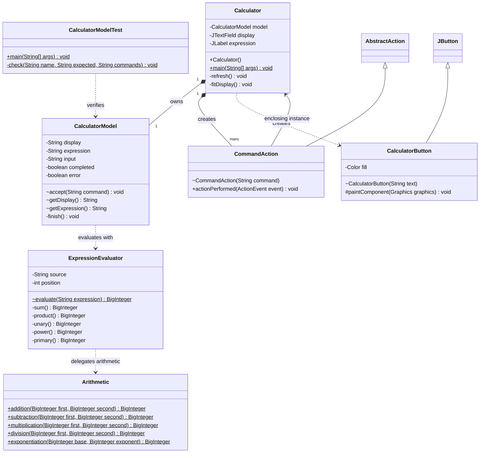
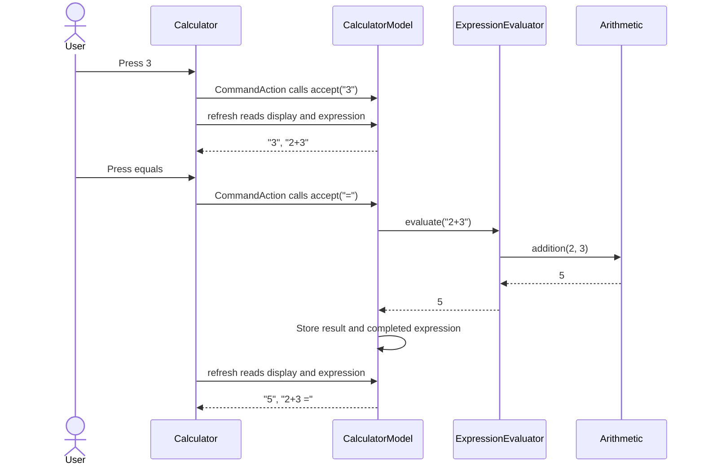

# Design and Implementation of a Java Swing Desktop Calculator

**Daniel Tongu**

CS380 — Introduction to Software Engineering

Lab 1: Integer Calculator

## Abstract

This project implements a desktop calculator using Java Swing. The modernized application provides a dark interface, rounded controls, separate expression and result displays, keyboard input, and a resizable window. A presentation-independent calculation model manages input transitions and evaluates integer arithmetic. Automated regression checks verify arithmetic, editing, operator selection, and error recovery. The implementation follows the lab’s integer-only requirement: division discards the fractional part toward zero, and decimal input is disabled.

**Index Terms—** Java, Swing, desktop application, calculator, integer arithmetic, software testing.

## I. Introduction

The calculator demonstrates event-driven interface programming and separation of presentation from calculation logic. Users can perform addition, subtraction, multiplication, and division through either the keypad or a physical keyboard. The application runs locally without third-party dependencies, accounts, or network services.

This README uses an IEEE-inspired technical-report structure. It is Markdown documentation rather than a submission formatted with an IEEE publication template.

## II. Functional Requirements

| Capability | Behavior |
| --- | --- |
| Arithmetic | Addition, subtraction, multiplication, and division |
| Integer arithmetic | Integer operands and results; `5 ÷ 2 = 2` and `−5 ÷ 2 = −2` |
| Unary minus | The minus key negates at the start or after an operator or opening parenthesis |
| Parentheses | Explicit grouping, including nested expressions |
| Clear all | Resets the value, expression, pending operation, and error |
| Exponentiation | `xʸ` or `^` raises an integer base to a nonnegative integer exponent |
| Backspace | Removes one expression character; clears a result or error |
| Expression display | Shows the pending operation or completed calculation |
| Error recovery | Division by zero displays an explanation; a digit or clear starts again |
| Input length | Accepts up to 16 entered digits per operand |
| Accessibility | Descriptive control names, keyboard operation, and visible button focus |

## III. System Design

### A. Presentation Layer

`Calculator.java` constructs the Swing window on the event dispatch thread. The interface uses a dark background, orange digit keys, brown arithmetic keys (`+`, `−`, `×`, `÷`, and `xʸ`) with gold symbols, gray parentheses and backspace keys, a pink clear-all key (`AC`), and a gold equals key. Rounded surfaces provide hover, pressed, and focus feedback. The on-screen heading is omitted; the native window title remains Calculator. The result font shrinks as text grows. Very long results remain selectable and horizontally scrollable in the display. The window starts at 400 × 620 pixels and permits resizing above a 360 × 560 minimum.


| Button group | Background | Label |
| --- | --- | --- |
| Digits `0`–`9` | Orange | Dark |
| Arithmetic `+`, `−`, `×`, `÷`, `xʸ` | Brown | Gold |
| Parentheses and backspace | Gray | White |
| Reset `AC` | Pink | Dark |
| Equals `=` | Gold | Dark |

`CalculatorButton.java` owns rounded painting and a single `KeyStyle` definition pairing the background and foreground of each button group. `Calculator.java` owns widget layout, accessible labels, and input actions. Buttons and keyboard shortcuts invoke the same command action. The expression line supplies context without mixing the pending expression into the editable operand state.

### B. Calculation Model

`CalculatorModel.java` maintains the entered expression, displayed value, completion state, and error state. It delegates expression evaluation to `ExpressionEvaluator.java`, which parses sums, products, unary minus, integer values, parentheses, and right-associative exponentiation using recursive descent. It has no Swing dependency and can therefore be verified without opening a desktop window.

The required `Arithmetic.java` utility class exposes the four required documented static methods: `addition`, `subtraction`, `multiplication`, and `division`. It also provides `exponentiation` for the power key. The class uses the conventional spelling `Arithmetic`; the PDF spells it `Arthimetic`. This naming correction is intentional. All arithmetic uses `BigInteger`, preserving integer results without fixed-width overflow. Division truncates toward zero at each division operation; for example, `5÷2×2` produces `4`. The evaluator delegates binary arithmetic and exponentiation to this class. Unary negation remains in the parser.

### C. Evaluation Rules

- Parentheses and exponentiation evaluate first, followed by unary minus, multiplication and division, then addition and subtraction. For example, `2 + 3 × 4 =` produces `14`, while `(2 + 3) × 4 =` produces `20`.
- The large operand display includes unary negation during entry, including negative operands after operators. A pending unary minus displays `-0`. Binary subtraction stays in the expression line.
- The same minus key represents subtraction and negation: `−5`, `2 × −5`, `2 − −5`, and `−(2 + 3)` are valid.
- Consecutive non-minus binary operators replace the pending operator. Minus is entered as unary negation when an operand is expected.
- Parentheses must balance before evaluation. A number or closing group followed by an opening parenthesis implies multiplication: `2(3+4)` gives `14`, and `(1+2)(3+4)` gives `21`. Explicit operators before a group also work, such as `2+(3+4)` and `2×(3+4)`. Implicit multiplication has the same precedence as explicit multiplication and division, evaluated from left to right; `8÷2(2+2)` gives `16`.
- Equals evaluates the complete expression and preserves a trailing equals sign in the expression line. Incomplete expressions report an error. Repeated equals leaves the result unchanged.
- Entering a digit or opening parenthesis after a result starts a new expression. Selecting an operator continues from the result.
- Decimal points and percent commands are ignored and have no keypad controls. Each typed operand is limited to 16 digits; expression entry is limited to 256 characters to bound parser nesting. Computed results can be longer.
- `xʸ` enters the exponent operator `^`. Examples: `2^3 = 8`, `(2+3)^4 = 625`, and `2^(2+3) = 32`. Powers associate from right to left: `2^3^2 = 512`. Exponentiation binds before unary minus: `−3^2 = −9`, while `(−3)^2 = 9`. After a result, select `xʸ`, enter an exponent, then equals.
- Exponents must evaluate to integers from 0 through 10000. Negative exponents report an error to preserve integer-only arithmetic. `0^0` returns `1`. Estimated power results are capped at one million bits to keep evaluation bounded.
- Backspace deletes one expression character. After a result or error it resets the calculator. `AC`, Escape, and Delete always reset all state.

### D. Application Flow

The Swing event dispatch thread builds the interface and processes each command. Clear, delete, and new numeric or opening-group input can recover from an error; other commands wait until the error is cleared. Every processed action refreshes the expression and result displays.



*Fig. 1. Application lifecycle and command-dispatch flow.*

### E. UML Class Diagram

The diagram shows the application classes, selected members, and Swing inheritance. `CommandAction` remains an inner class of `Calculator`; the button’s private `KeyStyle` enum centralizes color grouping. Swing widgets and internal helpers are omitted for clarity. The model owns input state, the evaluator owns expression grammar, and `Arithmetic` owns numeric operations.



*Fig. 2. UML class relationships for presentation, calculation, and verification.*

### F. UML Calculation Sequence

The sequence assumes `2` and `+` have already been entered. Entering `3` supplies the second operand; equals evaluates the pending operation. Division by zero follows the same action path but places the model in its error state instead of producing a result.



*Fig. 3. UML sequence for completing an addition through shared command actions.*

## IV. Build and Execution

### A. Prerequisites

Install a JDK version 17 or later. A graphical desktop session is required to run the interface. No external libraries or build tool are required.

### B. Compile and Run

From the project directory:

```bash
mkdir -p out
javac --release 17 -Xlint:all -d out Arithmetic.java Calculator.java CalculatorButton.java CalculatorModel.java ExpressionEvaluator.java
java -cp out Calculator
```

### C. Keyboard Controls

| Key | Action |
| --- | --- |
| `0`–`9` | Enter digits |
| `+`, `-`, `*`, `/` | Enter arithmetic operation; minus also negates |
| `^` | Enter exponentiation |
| `(`, `)` | Open or close an expression group |
| `Enter` or `=` | Evaluate |
| `Backspace` | Delete last expression character; reset a result or error |
| `Escape` or `Delete` | Clear all |
| `Tab`, `Shift+Tab`, `Space` | Navigate controls and activate the focused button |

## V. Verification

`CalculatorModelTest.java` supplies 92 dependency-free regression checks. Run them with:

```bash
mkdir -p out
javac --release 17 -Xlint:all -d out Arithmetic.java Calculator.java CalculatorButton.java CalculatorModel.java ExpressionEvaluator.java CalculatorModelTest.java
java -Djava.awt.headless=true -cp out CalculatorModelTest
```

Successful execution prints:

```text
Passed 92 calculator regression checks.
```

The checks cover arithmetic, integer division truncation, precedence, implicit multiplication, explicit operators before groups, nested parentheses, unary minus, negative operands, operator replacement, exponentiation of numbers, groups, and results, right associativity, negative-exponent rejection, power limits, expression editing, deletion of the last operand digit, keyboard and button exponent commands, repeated operator clicks, unsupported decimal/percent input, large integer results, invalid expressions, division by zero, recovery, result continuation, the input limit, and retention of the displayed equals sign.

Compilation with Java 17 compatibility and all 92 model checks passed during modernization. Automated checks do not verify desktop rendering, focus navigation, or physical keyboard behavior. Manually verify those features by launching the application, resizing the window, navigating the controls with Tab, and comparing mouse input with keyboard input.

### A. Lab Requirement Mapping

| Lab requirement | Implementation and evidence |
| --- | --- |
| `Arithmetic.java` with Javadoc | Required class and four required public static arithmetic methods plus exponentiation; Javadoc validation passes |
| Four arithmetic operations | Parser delegates to `Arithmetic`; regression checks cover each operation |
| Integer-only calculations | `BigInteger` throughout evaluation; no decimal key or binding |
| Truncated integer division | Positive and negative quotient tests, including `5÷2 = 2` |
| Negative numbers | Contextual unary minus and signed live operand display |
| Division by zero | Error display and clear, delete, or new-input recovery |
| Double-clicking operators | Repeated addition, multiplication, division, and minus sequences verified |
| Reset | `AC`, Escape, or Delete resets all model state |
| Driver with GUI components and listeners | `Calculator.java` owns Swing construction and command actions |
| Required runnable files | Six source files listed below; desktop validation remains a manual check |

A repeated minus denotes subtraction of a negative operand, such as `2−−3 = 5`. Incomplete or out-of-order expressions display an error rather than terminating the application.

To generate and validate the required arithmetic documentation:

```bash
javadoc -Xdoclint:all -d out/javadoc Arithmetic.java
```

For submission, include the source files and README. The lab recommends a ZIP of the project folder; exclude generated output and IDE metadata. The lab PDF remains the assignment reference.

## VI. Project Organization

| File | Purpose |
| --- | --- |
| `Calculator.java` | Swing interface, styling, actions, and keyboard bindings |
| `CalculatorModel.java` | Input editing, operand display, completion state, and errors |
| `ExpressionEvaluator.java` | Expression grammar, parentheses, precedence, and evaluation dispatch |
| `CalculatorButton.java` | Rounded painting and centralized key color styles |
| `Arithmetic.java` | Required arithmetic utility with four required Javadoc-documented integer operations and exponentiation |
| `CalculatorModelTest.java` | Executable model regression checks |
| `Lab1(IntegerCalculator).pdf` | Original lab document |
| `README.md` | Design, operation, and verification documentation |

## VII. Limitations and Future Work

The application does not implement decimal arithmetic, percentages, scientific functions, persistent history, or repeat-equals evaluation. Input limits apply to entered digits and expression length rather than computed result length. Results may exceed the visible display width. Potential extensions include calculation history and additional desktop accessibility testing.
