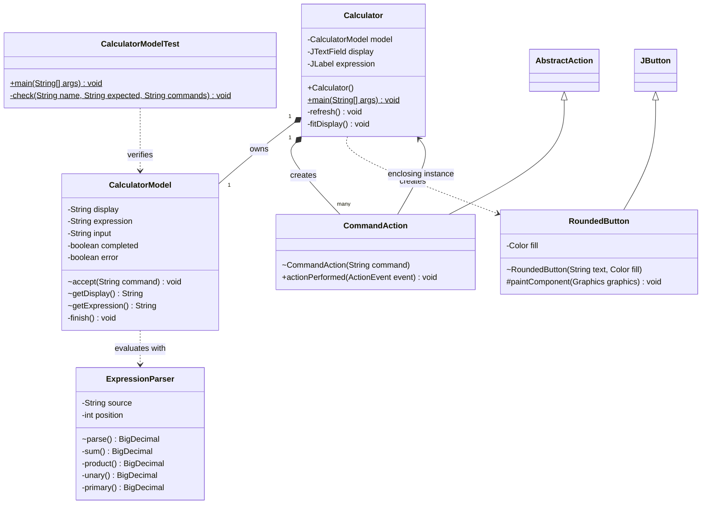
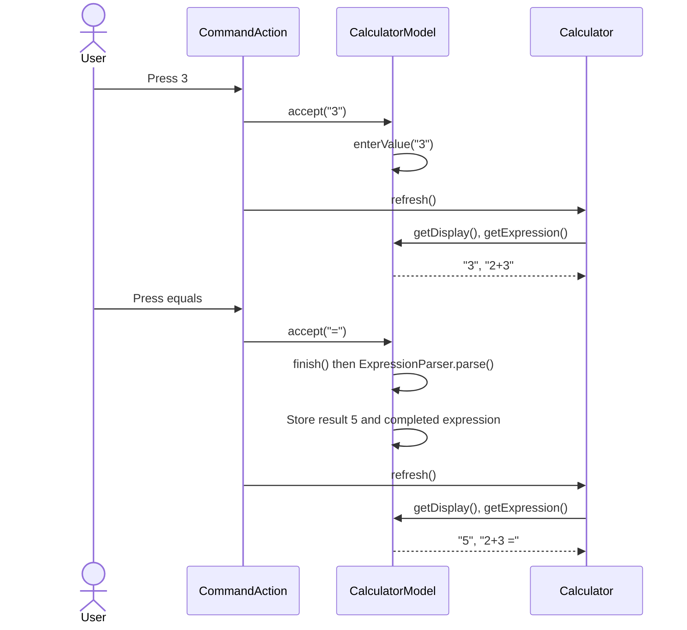

# Design and Implementation of a Java Swing Desktop Calculator

**Daniel Tongu**

CS380 — Introduction to Software Engineering

Lab 1: Integer Calculator

## Abstract

This project implements a desktop calculator using Java Swing. The modernized application provides a dark interface, rounded controls, separate expression and result displays, keyboard input, and a resizable window. A presentation-independent calculation model manages input transitions and evaluates decimal arithmetic. Automated regression checks verify arithmetic, editing, operator selection, and error recovery. Although the original lab is named Integer Calculator, this implementation also supports decimal operands and fractional results.

**Index Terms—** Java, Swing, desktop application, calculator, decimal arithmetic, software testing.

## I. Introduction

The calculator demonstrates event-driven interface programming and separation of presentation from calculation logic. Users can perform addition, subtraction, multiplication, and division through either the keypad or a physical keyboard. The application runs locally without third-party dependencies, accounts, or network services.

This README uses an IEEE-inspired technical-report structure. It is Markdown documentation rather than a submission formatted with an IEEE publication template.

## II. Functional Requirements

| Capability | Behavior |
| --- | --- |
| Arithmetic | Addition, subtraction, multiplication, and division |
| Decimal entry | Leading zero for decimal-only entry; duplicate decimal points ignored |
| Unary minus | The minus key negates at the start or after an operator or opening parenthesis |
| Parentheses | Explicit grouping, including nested expressions |
| Percentage | Divides the current value by 100 |
| Clear all | Resets the value, expression, pending operation, and error |
| Delete | `C` or Backspace removes the last expression character; clears a result or error |
| Expression display | Shows the pending operation or completed calculation |
| Error recovery | Division by zero displays an explanation; a digit or clear starts again |
| Input length | Accepts up to 16 entered digits per operand |
| Accessibility | Descriptive control names, keyboard operation, and visible button focus |

## III. System Design

### A. Presentation Layer

`Calculator.java` constructs the Swing window on the event dispatch thread. The interface uses a dark background, orange digit keys, brown arithmetic keys with gold symbols, gray parentheses and decimal keys, a blue delete key (`C`), a pink clear-all key (`AC`), and a gold equals key. Rounded surfaces provide hover, pressed, and focus feedback. The on-screen heading is omitted; the native window title remains Calculator. The result font shrinks as text grows. Very long results remain selectable and horizontally scrollable in the display. The window starts at 400 × 620 pixels and permits resizing above a 570 × 560 minimum.

Buttons and keyboard shortcuts invoke the same command action. The expression line supplies context without mixing the pending expression into the editable operand state.

### B. Calculation Model

`CalculatorModel.java` maintains the entered expression, displayed value, completion state, and error state. Its nested `ExpressionParser` evaluates sums, products, unary minus, decimal values, parentheses, and postfix percentages using recursive descent. It has no Swing dependency and can therefore be verified without opening a desktop window.

Arithmetic uses `BigDecimal`. Addition, subtraction, and multiplication preserve decimal precision. Division uses `MathContext.DECIMAL64`, which provides 16 significant digits with half-even rounding. Results omit unnecessary trailing zeros and use ordinary decimal notation.

### C. Evaluation Rules

- Parentheses evaluate first, followed by unary minus, multiplication and division, then addition and subtraction. For example, `2 + 3 × 4 =` produces `14`, while `(2 + 3) × 4 =` produces `20`.
- The large operand display includes unary negation during entry, including negative decimals and operands after operators. A pending unary minus displays `-0`. Binary subtraction stays in the expression line.
- The same minus key represents subtraction and negation: `−5`, `2 × −5`, `2 − −5`, and `−(2 + 3)` are valid.
- Consecutive non-minus binary operators replace the pending operator. Minus is entered as unary negation when an operand is expected.
- Parentheses must balance before evaluation. A number or closing group followed by an opening parenthesis implies multiplication: `2(3+4)` gives `14`, and `(1+2)(3+4)` gives `21`. Explicit operators before a group also work, such as `2+(3+4)` and `2×(3+4)`. Implicit multiplication has the same precedence as explicit multiplication and division, evaluated from left to right; `8÷2(2+2)` gives `16`.
- Equals evaluates the complete expression and preserves a trailing equals sign in the expression line. Incomplete expressions report an error. Repeated equals leaves the result unchanged.
- Entering a digit, decimal point, or opening parenthesis after a result starts a new expression. Selecting an operator continues from the result.
- Percentage divides the preceding number or parenthesized group by 100; it remains available through the `%` keyboard shortcut.
- `C` and Backspace delete one expression character. After a result or error, they reset the calculator. `AC`, Escape, and Delete always reset all state.

### D. Application Flow

The Swing event dispatch thread builds the interface and processes each command. Clear, delete, and new numeric or opening-group input can recover from an error; other commands wait until the error is cleared. Every processed action refreshes the expression and result displays.


*Fig. 1. Application lifecycle and command-dispatch flow.*

### E. UML Class Diagram

The diagram shows the application classes, selected members, and Swing inheritance. `CommandAction` is a non-static inner class of `Calculator`; `RoundedButton` and `ExpressionParser` are static nested classes in their respective enclosing classes. Swing widgets and internal helper methods are omitted for clarity.



*Fig. 2. UML class relationships for presentation, calculation, and verification.*

### F. UML Calculation Sequence

The sequence assumes `2` and `+` have already been entered. Entering `3` supplies the second operand; equals evaluates the pending operation. Division by zero follows the same action path but places the model in its error state instead of producing a result.



*Fig. 3. UML sequence for completing an addition through shared command actions.*

## IV. Build and Execution

### A. Prerequisites

Install a JDK version 17 or later. A graphical desktop session is required to run the interface. No external libraries or build tool are required.

### B. Compile and Run

From the project directory:

```bash
mkdir -p out
javac --release 17 -Xlint:all -d out Calculator.java CalculatorModel.java
java -cp out Calculator
```

### C. Keyboard Controls

| Key | Action |
| --- | --- |
| `0`–`9` | Enter digits |
| `.` | Enter decimal point |
| `+`, `-`, `*`, `/` | Enter arithmetic operation; minus also negates |
| `(`, `)` | Open or close an expression group |
| `%` | Divide preceding value or group by 100 |
| `Enter` or `=` | Evaluate |
| `Backspace` | Delete last expression character; reset a result or error |
| `Escape` or `Delete` | Clear all |
| `Tab`, `Shift+Tab`, `Space` | Navigate controls and activate the focused button |

## V. Verification

`CalculatorModelTest.java` supplies 57 dependency-free regression checks. Run them with:

```bash
mkdir -p out
javac --release 17 -Xlint:all -d out Calculator.java CalculatorModel.java CalculatorModelTest.java
java -Djava.awt.headless=true -cp out CalculatorModelTest
```

Successful execution prints:

```text
Passed 57 calculator regression checks.
```

The checks cover arithmetic, decimal precision, precedence, implicit multiplication, explicit operators before groups, nested parentheses, unary minus, negative operands, operator replacement, expression editing, percentages, invalid expressions, division by zero, recovery, result continuation, the input limit, and retention of the displayed equals sign.

Compilation with Java 17 compatibility and all 57 model checks passed during modernization. Automated checks do not verify desktop rendering, focus navigation, or physical keyboard behavior. Manually verify those features by launching the application, resizing the window, navigating the controls with Tab, and comparing mouse input with keyboard input.

## VI. Project Organization

| File | Purpose |
| --- | --- |
| `Calculator.java` | Swing interface, styling, actions, and keyboard bindings |
| `CalculatorModel.java` | Input state and decimal arithmetic |
| `CalculatorModelTest.java` | Executable model regression checks |
| `Lab1(IntegerCalculator).pdf` | Original lab document |
| `README.md` | Design, operation, and verification documentation |

## VII. Limitations and Future Work

The application does not implement scientific functions, persistent history, or repeat-equals evaluation. The input limit applies to typed digits rather than computed result length. Results may exceed the visible display width. Potential extensions include calculation history and additional desktop accessibility testing.
